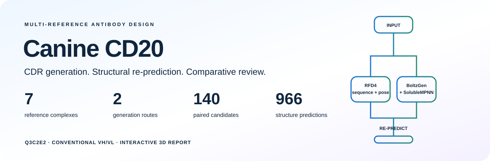
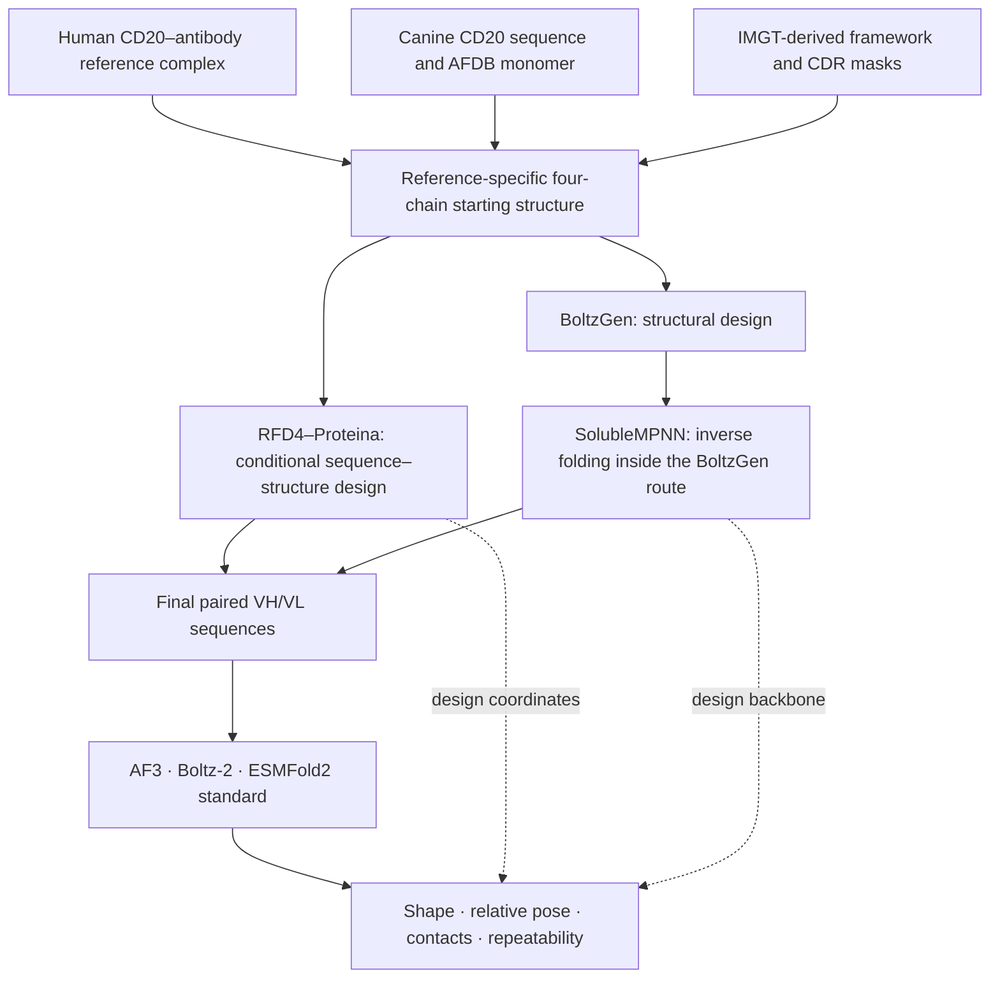

<p align="center">
  
</p>

<h1 align="center">Canine CD20 Design</h1>

<p align="center">
  <strong>Multi-reference antibody CDR design, followed by structural re-prediction.</strong><br>
  A browsable study of what the generators proposed, what the predictors recovered,<br>
  and where the resulting structures agree or diverge.
</p>

<p align="center">
  <a href="https://zhichao-chang.github.io/canine-cd20-design/"></a>
  
  
</p>

<p align="center">
  <a href="https://zhichao-chang.github.io/canine-cd20-design/"><strong>Open the report ↗</strong></a> &nbsp;·&nbsp;
  <a href="https://zhichao-chang.github.io/canine-cd20-design/teaching.html">Teaching notes</a> &nbsp;·&nbsp;
  <a href="https://zhichao-chang.github.io/canine-cd20-design/6vja/index.html">6VJA viewer</a> &nbsp;·&nbsp;
  <a href="#study-workflow">Study workflow</a>
</p>

---

This study starts from **seven human CD20–antibody reference complexes** and redesigns antibody CDRs against **canine CD20**. Each reference is processed separately through two generation routes, followed by the same three structure predictors. The interactive report connects the input structures, design constraints, candidate sequences, comparison definitions, and findings.

| Reference complexes | Generation routes | Candidate VH/VL pairs | Canonical predictions |
| :---: | :---: | :---: | :---: |
| **7** | **2** | **140** | **966** |

## Study workflow



- **Shared conditions:** two canine CD20 cores, the reference's paired VH/VL frameworks, six designable CDRs, fixed chain lengths, and extracellular binding-site hints.
- **Generation:** ten candidates per route and reference. RFD4 jointly proposes sequence and structure; BoltzGen runs `design` and `inverse_folding`, with SolubleMPNN selecting sequences for the designed backbone.
- **Re-prediction:** final four-chain sequences are supplied to AF3, Boltz-2, and ESMFold2 standard with empty MSAs and no templates. The generated pose is kept separately for comparison.
- **Review:** all 140 candidates receive an initial three-model screen; a fixed set of 70 receives additional seed sampling. Parent controls bring the total to 966 predictions.

## Explore the evidence

| In the report | What it helps you inspect |
| :--- | :--- |
| **Input/output flowchart** | Exactly what each generator receives, can change, and returns. |
| **Model guide** | Two generators, the nested inverse-folding step, and three predictors. |
| **Interactive structures** | Experimental complexes, canine CD20, parent controls, and selected designs. |
| **Explicit comparisons** | Both structures being compared, the alignment region, the measured atoms, and the meaning of each metric. |
| **Structural diagnostics** | CD20 deformation, Fv/CDR shape, relative pose, contact footprints, and seed sensitivity. |
| **Inspectable evidence** | Reviewed values, calculation definitions, source identities, and candidate FASTA downloads. |

The report is written in Chinese. The computational results describe candidate designs and model agreement; canine binding, affinity, and function remain to be measured experimentally.

## View locally

The published report runs independently of the author's computer. No Python environment, PyMOL installation, model weights, or GPU server is needed to view it. Use a modern browser with WebGL and `DecompressionStream` support.

For a local copy:

```bash
git clone https://github.com/ZhiChao-Chang/canine-cd20-design.git
cd canine-cd20-design
python3 -m http.server 8000 --bind 127.0.0.1
```

Open **http://127.0.0.1:8000/**. The main HTML is approximately 42 MB because it includes the reviewed data, molecular coordinates, and display code.

## Repository contents

```text
index.html                   Self-contained interactive research report
teaching.html                Teaching notes
6vja/                        Reference viewer, coordinates, and PyMOL assets
docs/cd20-design-banner.svg   Repository cover
publication-manifest.json    Published file identities and checksums
```

This repository publishes the static study presentation. GitHub Pages serves the `main` branch from the repository root; retain the relative paths when copying its files.

## Sources and companion tool

Experimental structures originate from **RCSB PDB**; the starting canine monomer originates from **AlphaFold DB**. The report retains software versions and structure provenance. Original data and third-party software retain their applicable rights; the embedded 3Dmol.js license is included with the viewers.

The independent FASTA numbering program has its own repository: **[antibody-numbering](https://github.com/ZhiChao-Chang/antibody-numbering)**. Its role here is to map antibody framework and CDR positions.
